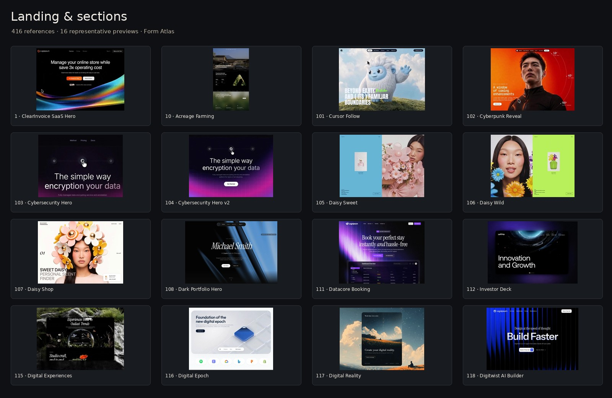
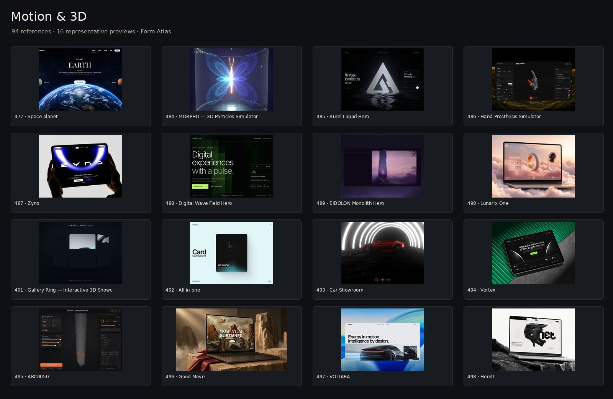
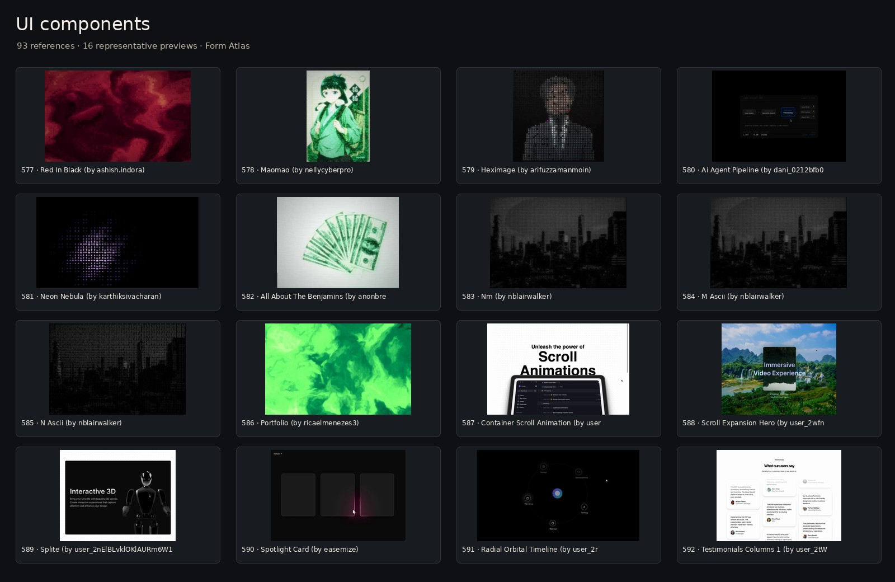
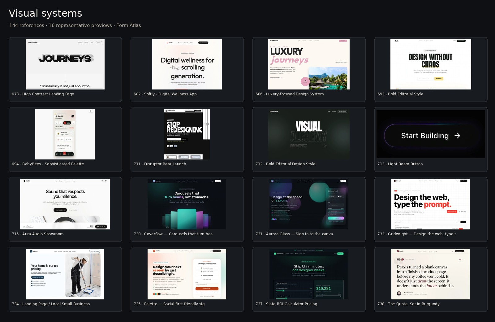
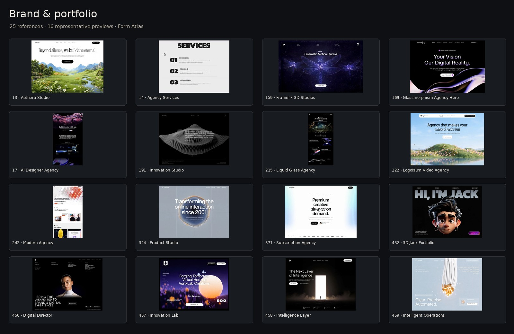
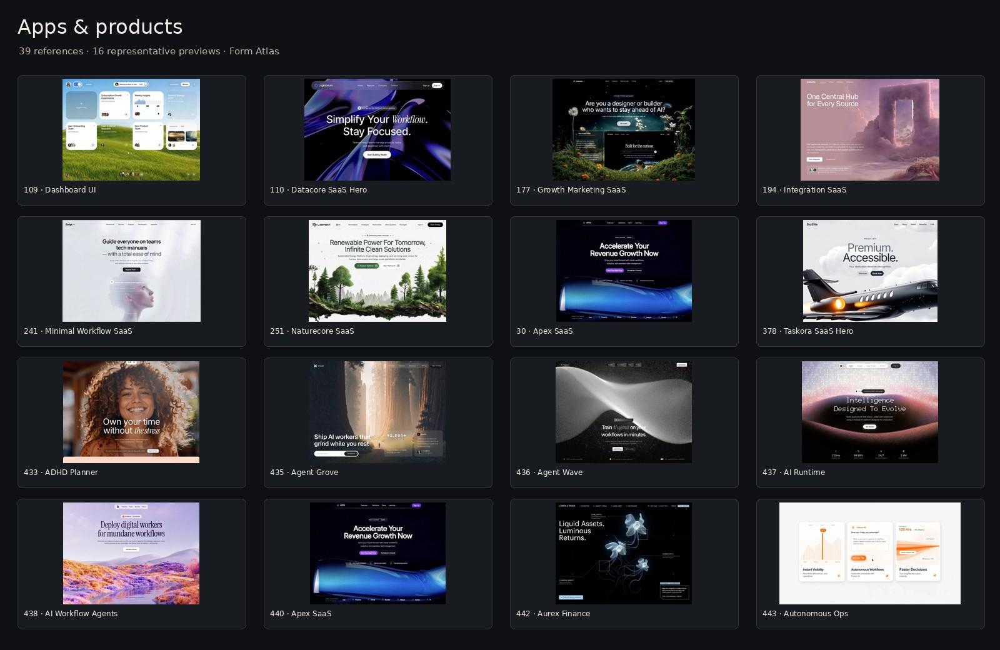
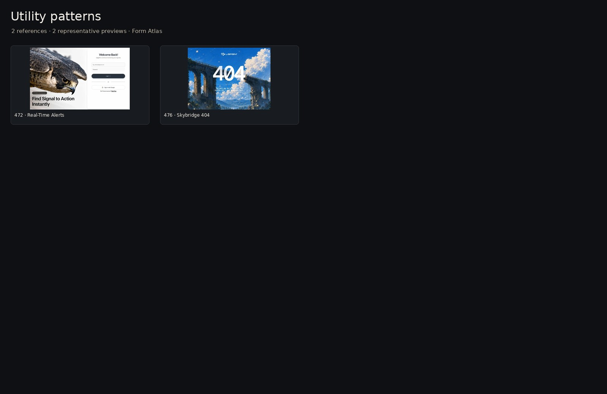
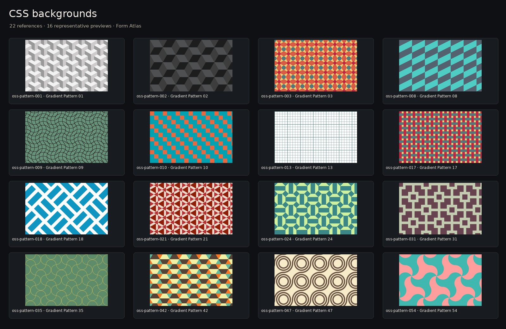
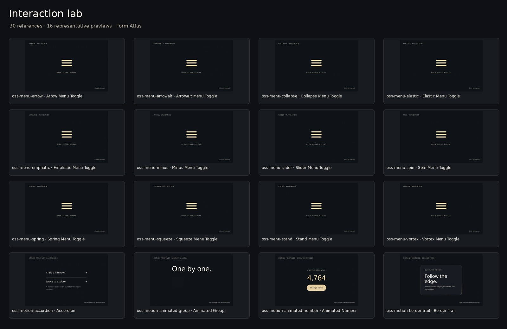

# The design collections

865 complete references across nine collections. All prompts and code are preserved; source previews now use the current recovery. The overview boards below show representative current previews, not invented designs. Unavailable previews are explicitly labeled in the app. See `MEDIA_PROVENANCE.json` for evidence and `README_FIRST.md` for usage.

## Landing & sections — 416 references

Examples:

- [ClearInvoice SaaS Hero](PROMPTS/01-Landing-and-Sections/001-3.md)
- [Acreage Farming](PROMPTS/01-Landing-and-Sections/010-acreage-farming.md)
- [Cursor Follow](PROMPTS/01-Landing-and-Sections/101-cursor-follow.md)
- [Cyberpunk Reveal](PROMPTS/01-Landing-and-Sections/102-cyberpunk-reveal.md)
- [Cybersecurity Hero](PROMPTS/01-Landing-and-Sections/103-cybersecurity-hero.md)
- [Cybersecurity Hero v2](PROMPTS/01-Landing-and-Sections/104-cybersecurity-hero-v2.md)
- [Daisy Sweet](PROMPTS/01-Landing-and-Sections/105-daisy-sweet.md)
- [Daisy Wild](PROMPTS/01-Landing-and-Sections/106-daisy-wild.md)

## Motion & 3D — 94 references

Examples:

- [Space planet](PROMPTS/02-Motion-and-3D/477-space-planet.md)
- [HorizonX MORPHO — 3D Particles Simulator](PROMPTS/02-Motion-and-3D/484-horizonx-morpho-3d-particles-simulator.md)
- [HorizonX Aurel Liquid Hero](PROMPTS/02-Motion-and-3D/485-horizonx-aurel-liquid-hero.md)
- [HorizonX Hand Prosthesis Simulator](PROMPTS/02-Motion-and-3D/486-horizonx-hand-prosthesis-simulator.md)
- [HorizonX Zyno](PROMPTS/02-Motion-and-3D/487-horizonx-zyno.md)
- [HorizonX Digital Wave Field Hero](PROMPTS/02-Motion-and-3D/488-horizonx-digital-wave-field-hero.md)
- [HorizonX EIDOLON Monolith Hero](PROMPTS/02-Motion-and-3D/489-horizonx-eidolon-monolith-hero.md)
- [HorizonX Lunarix One](PROMPTS/02-Motion-and-3D/490-horizonx-lunarix-one.md)

## UI components — 93 references

Examples:

- [21st.dev Red In Black (by ashish.indora)](PROMPTS/03-UI-Components/577-21st-dev-red-in-black-by-ashish-indora.md)
- [21st.dev Maomao (by nellycyberpro)](PROMPTS/03-UI-Components/578-21st-dev-maomao-by-nellycyberpro.md)
- [21st.dev Heximage (by arifuzzamanmoin)](PROMPTS/03-UI-Components/579-21st-dev-heximage-by-arifuzzamanmoin.md)
- [21st.dev Ai Agent Pipeline (by dani_0212bfb0)](PROMPTS/03-UI-Components/580-21st-dev-ai-agent-pipeline-by-dani-0212bfb0.md)
- [21st.dev Neon Nebula (by karthiksivacharan)](PROMPTS/03-UI-Components/581-21st-dev-neon-nebula-by-karthiksivacharan.md)
- [21st.dev All About The Benjamins (by anonbreadwinner)](PROMPTS/03-UI-Components/582-21st-dev-all-about-the-benjamins-by-anonbreadwinner.md)
- [21st.dev Nm (by nblairwalker)](PROMPTS/03-UI-Components/583-21st-dev-nm-by-nblairwalker.md)
- [21st.dev M Ascii (by nblairwalker)](PROMPTS/03-UI-Components/584-21st-dev-m-ascii-by-nblairwalker.md)

## Visual systems — 144 references

Examples:

- [Superdesign High Contrast Landing Page](PROMPTS/04-Visual-Design-Systems/673-superdesign-high-contrast-landing-page.md)
- [Superdesign Softly - Digital Wellness App](PROMPTS/04-Visual-Design-Systems/682-superdesign-softly-digital-wellness-app.md)
- [Superdesign Luxury-focused Design System](PROMPTS/04-Visual-Design-Systems/686-superdesign-luxury-focused-design-system.md)
- [Superdesign Bold Editorial Style](PROMPTS/04-Visual-Design-Systems/693-superdesign-bold-editorial-style.md)
- [Superdesign BabyBites - Sophisticated Palette](PROMPTS/04-Visual-Design-Systems/694-superdesign-babybites-sophisticated-palette.md)
- [Superdesign Disruptor Beta Launch](PROMPTS/04-Visual-Design-Systems/711-superdesign-disruptor-beta-launch.md)
- [Superdesign Bold Editorial Design Style](PROMPTS/04-Visual-Design-Systems/712-superdesign-bold-editorial-design-style.md)
- [Superdesign Light Beam Button](PROMPTS/04-Visual-Design-Systems/713-superdesign-light-beam-button.md)

## Brand & portfolio — 25 references

Examples:

- [Aethera Studio](PROMPTS/05-Brand-and-Portfolio/013-aethera-studio.md)
- [Agency Services](PROMPTS/05-Brand-and-Portfolio/014-agency-services.md)
- [Framelix 3D Studios](PROMPTS/05-Brand-and-Portfolio/159-framelix-3d-studios.md)
- [Glassmorphism Agency Hero](PROMPTS/05-Brand-and-Portfolio/169-glassmorphism-agency-hero.md)
- [AI Designer Agency](PROMPTS/05-Brand-and-Portfolio/017-ai-designer-agency.md)
- [Innovation Studio](PROMPTS/05-Brand-and-Portfolio/191-innovation-studio.md)
- [Liquid Glass Agency](PROMPTS/05-Brand-and-Portfolio/215-liquid-glass-agency.md)
- [Logoisum Video Agency](PROMPTS/05-Brand-and-Portfolio/222-logoisum-video-agency.md)

## Apps & products — 39 references

Examples:

- [Dashboard UI](PROMPTS/06-Apps-and-Products/109-dashboard-ui.md)
- [Datacore SaaS Hero](PROMPTS/06-Apps-and-Products/110-datacore-saas-hero.md)
- [Growth Marketing SaaS](PROMPTS/06-Apps-and-Products/177-growth-marketing-saas.md)
- [Integration SaaS](PROMPTS/06-Apps-and-Products/194-integration-saas.md)
- [Minimal Workflow SaaS](PROMPTS/06-Apps-and-Products/241-minimal-workflow-saas.md)
- [Naturecore SaaS](PROMPTS/06-Apps-and-Products/251-naturecore-saas.md)
- [Apex SaaS](PROMPTS/06-Apps-and-Products/030-apex-saas-hero.md)
- [Taskora SaaS Hero](PROMPTS/06-Apps-and-Products/378-taskora-saas-hero.md)

## Utility patterns — 2 references

Examples:

- [Real-Time Alerts](PROMPTS/07-Utility-Patterns/472-real-time-alerts.md)
- [Skybridge 404](PROMPTS/07-Utility-Patterns/476-skybridge-404.md)

## CSS backgrounds — 22 references

Examples:

- [Gradient Pattern 01](PROMPTS/09-Open-Source/oss-pattern-001.md)
- [Gradient Pattern 02](PROMPTS/09-Open-Source/oss-pattern-002.md)
- [Gradient Pattern 03](PROMPTS/09-Open-Source/oss-pattern-003.md)
- [Gradient Pattern 08](PROMPTS/09-Open-Source/oss-pattern-008.md)
- [Gradient Pattern 09](PROMPTS/09-Open-Source/oss-pattern-009.md)
- [Gradient Pattern 10](PROMPTS/09-Open-Source/oss-pattern-010.md)
- [Gradient Pattern 13](PROMPTS/09-Open-Source/oss-pattern-013.md)
- [Gradient Pattern 17](PROMPTS/09-Open-Source/oss-pattern-017.md)

## Interaction lab — 30 references

Examples:

- [Arrow Menu Toggle](PROMPTS/09-Open-Source/oss-menu-arrow.md)
- [Arrowalt Menu Toggle](PROMPTS/09-Open-Source/oss-menu-arrowalt.md)
- [Collapse Menu Toggle](PROMPTS/09-Open-Source/oss-menu-collapse.md)
- [Elastic Menu Toggle](PROMPTS/09-Open-Source/oss-menu-elastic.md)
- [Emphatic Menu Toggle](PROMPTS/09-Open-Source/oss-menu-emphatic.md)
- [Minus Menu Toggle](PROMPTS/09-Open-Source/oss-menu-minus.md)
- [Slider Menu Toggle](PROMPTS/09-Open-Source/oss-menu-slider.md)
- [Spin Menu Toggle](PROMPTS/09-Open-Source/oss-menu-spin.md)
